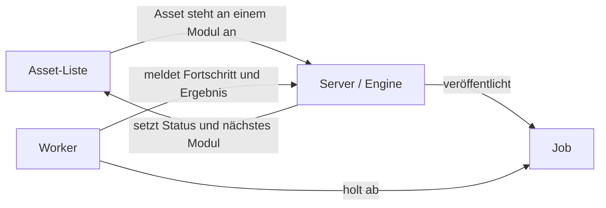
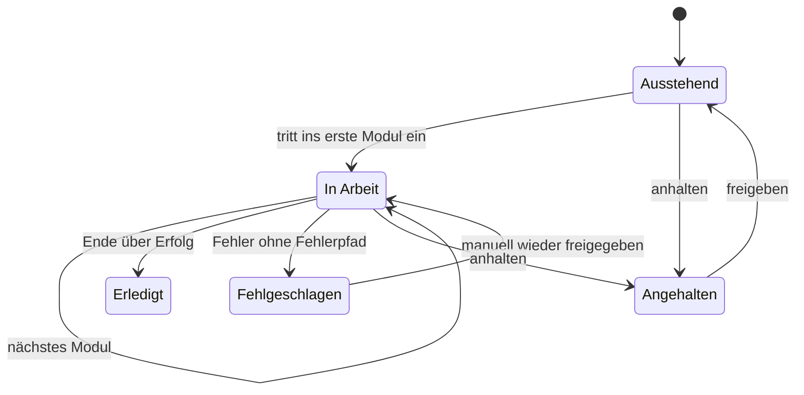
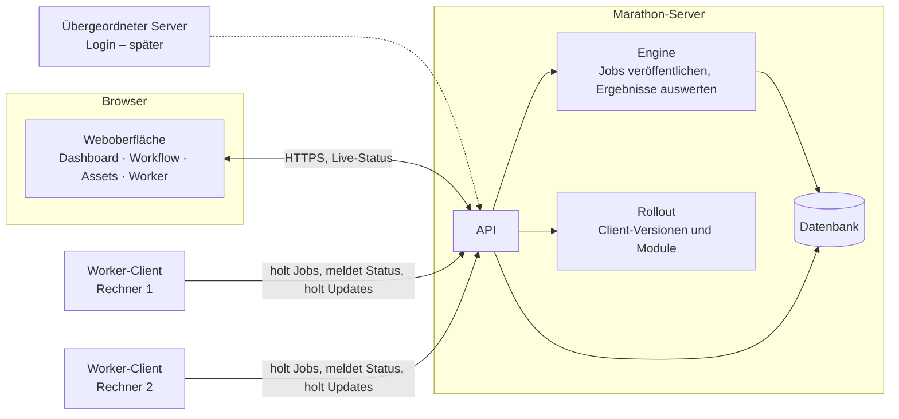

# Marathon 2.0 – Architekturkonzept

**Stand:** 05.11.2026 · Martin, CodeZilla
**Status:** Kernkonzept (Gerüst) und Startumfang. Kein Pflichtenheft, kein Code. Startumfang siehe Abschnitt 11, Ausbau siehe Abschnitt 12.

---

## 1. Ziel und Rahmen

- **Workflow-Engine als Webanwendung** im lokalen Netz, optional öffentlich erreichbar.
- **Ein Server** liefert die Webseite aus, steuert die Workflows und hält die Datenbank.
- **Worker-Rechner** bekommen einen kleinen installierten **Worker-Client**, der mit dem Server spricht und sich selbst aktualisiert.
- **Node-Editor im Browser** zum Bauen der Workflows.
- **Bedienung und Oberfläche nach Vorbild FileFlows** (siehe Quellen).
- **Eigener, schlanker Kern** aus fertigen Bausteinen; Neubau ohne Übernahme von Code.
- **Login und Benutzerverwaltung** kommen später über einen übergeordneten Server; jetzt nur eine Andockstelle vorsehen.
- **Namen:** „m2“ ist nur die interne Bezeichnung. Im Code heißt alles `marathon`, Startversion **2.0.0**.
- **Betriebssystem:** Start auf Windows 11 (Server und Worker), später Linux. Der Code ist von Anfang an plattformunabhängig.
- **Vorgehen:** Schnell einen lauffähigen Prototyp und eine erste lauffähige Version bauen, aber von Anfang an so angelegt, dass sie leicht skaliert. Danach Stück für Stück erweitern.

**Leitplanken für Skalierbarkeit**

- Der Server hält keinen Zustand im Arbeitsspeicher; alles steht in der Datenbank. So können später mehrere Server-Prozesse parallel laufen.
- Server, Worker-Client und Oberfläche sprechen nur über klar definierte, versionierte Schnittstellen.
- Änderungen am Datenbankaufbau nur über Migrationen.
- Neue Modultypen kommen ohne Änderung am Kern dazu.
- Einstellungen stehen in Konfigurationsdateien, nicht im Code.

## 2. Kernidee

> Es gibt eine **Liste von Assets**. Die Assets durchlaufen einen **Workflow** aus **Modulen**.
> Damit ein Asset ein Modul durchläuft, veröffentlicht der Server einen **Job**. **Worker** holen sich Jobs, verarbeiten sie und melden das Ergebnis.
> Mit jedem Ergebnis ändert sich der **Status** des Assets auf der Liste, bis es das Ende des Workflows erreicht.

Was ein Asset inhaltlich ist, spielt für den Kern keine Rolle. Ein Asset ist ein Listeneintrag mit Kennung, Name und frei belegbaren Metadaten. Erst die Module wissen, was sie damit tun.



## 3. Begriffe

| Begriff | Bedeutung |
|---|---|
| **Workflow** | Versionierte Definition: Module und ihre Verbindungen. Jeder Workflow hat genau eine Asset-Liste. |
| **Modultyp** | Ein Baustein aus dem Katalog (z. B. „Dateien bewegen“). Beschreibt Eingang, Ausgänge, Einstellungen und benötigte Fähigkeiten. |
| **Modul** | Ein im Workflow platzierter Modultyp mit eigenen Einstellungen. |
| **Ausgang** | Benannter Ausgang eines Moduls (mindestens *Erfolg* und *Fehler*). Eine Verbindung führt vom Ausgang zum nächsten Modul. |
| **Asset** | Ein Eintrag auf der Liste eines Workflows. Hat einen Status, eine Position (aktuelles Modul) und eine Historie. |
| **Job** | Ein Arbeitsauftrag: ein Modul für ein oder mehrere Assets (Sammeljob). Hat Versuche, Fortschritt und ein Ergebnis je Asset. |
| **Worker** | Ein Rechner mit installiertem Worker-Client. Hat Fähigkeiten, eine maximale Zahl paralleler Jobs, einen Status und eine Client-Version. |
| **Historie** | Jeder Statuswechsel, jede Fehler- und Erfolgsmeldung wird als Eintrag angehängt und nie verändert. |

## 4. Der Kreislauf (Gerüst der Engine)

1. **Asset kommt auf die Liste** (manuell, per Import oder über ein Quell-Modul – siehe 12).
2. **Asset steht an einem Modul an.** Der Server veröffentlicht dafür einen Job. Bei Sammeljobs sammelt das Modul zuerst mehrere Assets nach einer Regel (z. B. gleicher Schlüssel) und veröffentlicht dann einen Job.
3. **Worker holt Job ab.** Der Worker fragt nach Arbeit, die zu seinen Fähigkeiten passt. Der Server teilt den passenden Job mit der höchsten Priorität zu.
4. **Worker verarbeitet** und meldet laufend Fortschritt, Log-Zeilen und – bei Sammeljobs – Teilergebnisse je Asset.
5. **Server wertet das Ergebnis je Asset aus:** Der gemeldete Ausgang bestimmt das nächste Modul.
6. **Ende:** Führt kein Ausgang weiter, ist das Asset bei *Erfolg* erledigt, bei *Fehler* fehlgeschlagen.

**Grundregeln**

- **Der Server entscheidet, der Worker führt aus.** Der Worker kennt keinen Workflow, nur seinen Job.
- **Abholen statt Zuschieben:** Worker bauen nur ausgehende Verbindungen auf.
- **Prioritäten:** Reihenfolge auf der Liste und Priorität je Workflow; einzelne Assets lassen sich nach oben schieben.

## 5. Zustände

### 5.1 Asset

Der Status eines Assets hat zwei Ebenen: den **Gesamtstatus** auf der Liste und den **Schrittstatus** am aktuellen Modul.

| Gesamtstatus | Bedeutung | Sicht „wurde / wird / soll“ |
|---|---|---|
| **Ausstehend** | Auf der Liste, Workflow noch nicht begonnen | soll verarbeitet werden |
| **In Arbeit** | Im Workflow unterwegs; Schrittstatus *wartet* (Job offen oder Sammeln) oder *läuft* (Job zugeteilt) | wird verarbeitet |
| **Erledigt** | Ende des Workflows über *Erfolg* erreicht | wurde verarbeitet |
| **Fehlgeschlagen** | Fehler ohne weiterführenden Fehlerpfad; wartet auf Eingriff | wurde verarbeitet (mit Fehler) |
| **Angehalten** | Manuell zurückgestellt | – |



### 5.2 Job

`offen` → `zugeteilt` (läuft) → `erfolgreich` | `fehlgeschlagen` | `abgebrochen`.
Läuft die Zuteilung ab, geht der Job zurück auf `offen`.

### 5.3 Worker

`neu` (hat sich gemeldet, noch nicht freigegeben) → `bereit` ⇄ `beschäftigt`; dazu `offline` (keine Meldung), `gesperrt` (manuell) und `Update` (aktualisiert sich gerade).

## 6. Komponenten



### 6.1 Marathon-Server

- Liefert die Weboberfläche aus und stellt die API bereit.
- **Engine:** veröffentlicht Jobs, teilt sie zu, wertet Ergebnisse aus, schreibt Status und Historie.
- **Rollout:** hält freigegebene Client-Versionen und Module bereit.
- Live-Status an die Oberfläche (Server-Sent Events oder WebSocket).

### 6.2 Worker-Client

- Meldet sich beim Server an und erscheint in der Oberfläche als *neu*. Freigeben, benennen, Fähigkeiten und Parallelität setzen erfolgt in der Oberfläche.
- Sendet regelmäßig ein Lebenszeichen mit Status, laufenden Jobs und Client-Version.
- Holt Jobs, führt das Modul aus, meldet Fortschritt, Log und Ergebnis.

### 6.3 Auto-Update (von Anfang an)

- **Rollout geht vom Server aus:** In der Oberfläche wird eine Client-Version für alle oder ausgewählte Worker freigegeben.
- Der Client erfährt über das Lebenszeichen, dass eine neue Version für ihn bereitsteht.
- Ablauf im Client: Paket laden → Prüfsumme prüfen → keine neuen Jobs annehmen → laufende Jobs beenden lassen → tauschen → neu starten → neue Version melden.
- **Rückfall:** Startet die neue Version nicht sauber, kehrt der Client zur vorherigen Version zurück und meldet den Fehler.
- **Aufbau:** ein kleiner Starter, der sich selten ändert, und die eigentliche Client-Laufzeit, die der Starter austauscht.
- **Versionen:** Server und Client tragen dieselbe Versionsnummer (Start 2.0.0).
- Module werden über denselben Weg verteilt.

## 7. Datenhaltung

**Inhalt der Datenbank**

- Workflows mit Versionen, Modulen, Einstellungen und Verbindungen
- Assets mit Gesamtstatus, Schrittstatus, Position und Metadaten
- Jobs mit Versuchen, Worker, Fortschritt und Ergebnis je Asset
- Historie: Statuswechsel, Fehler- und Erfolgsmeldungen, Logs
- Worker und Client-Versionen

**Prinzip:** Der aktuelle Zustand wird direkt gespeichert. Jede Änderung schreibt in derselben Transaktion einen Eintrag in die Historie. So ist der Zustand schnell abfragbar und die Historie trotzdem vollständig.

**Festgelegt:** eine Datenbank für alles, mit einer Aufräumregel für alte Daten (Details in Block 1, Abschnitt 12).

**Datenbanksystem: PostgreSQL** von Anfang an:

- viele gleichzeitige Schreibzugriffe (Lebenszeichen, Fortschritt, Logs vieler Worker)
- frei belegbare Asset-Metadaten speicher- und durchsuchbar
- Benachrichtigung bei Änderungen für den Live-Status
- Aufräumen großer Historien blockweise
- mehrere Server-Prozesse gleichzeitig möglich

## 8. Oberfläche (Vorbild FileFlows)

**Gestaltung**

- **Nur Dark Theme.** Ein helles Theme gibt es vorerst nicht.
- **Schrift:** eine moderne Monospace-Schrift für die gesamte Oberfläche. Der Look darf technisch-nerdig sein. Vorschlag: JetBrains Mono (freie Lizenz OFL).
- Farben und Schrift sind zentral festgelegt; jeder Gesamtstatus hat überall dieselbe Farbe.
- Schriftdateien werden lokal ausgeliefert.

**Navigation:** feste Seitenleiste mit gleichrangigen Einträgen **Dashboard**, **Workflows**, **Assets**, dazu **Worker** und **Einstellungen**. Innerhalb eines Workflows wechseln Reiter mit einem Klick zwischen **Module** und **Assets**. Jede Dashboard-Zeile springt direkt in beide Ansichten. Die Asset-Ansicht ist auch global erreichbar (mit Filter nach Workflow).

### 8.1 Dashboard

- Eine Kachel oder Zeile je Workflow mit den allgemeinen Workflow-Daten.
- Welche Daten das sind, wird noch festgelegt (z. B. aktiv/pausiert, Anzahl Assets je Gesamtstatus, Fehler, Durchsatz).

### 8.2 Workflow-Ansicht (Module)

- Der Workflow als Graph auf einer Arbeitsfläche, mit zwei Modi:
  - **Überwachen:** Jedes Modul zeigt live seine Zähler (wartet, läuft, erledigt, fehlgeschlagen).
  - **Bearbeiten:** Modultypen aus der Seitenleiste auf die Fläche ziehen, Ausgänge mit Eingängen verbinden. Ausgänge sind beschriftet und zeigen beim Überfahren ihre Bedeutung. Doppelklick öffnet die Einstellungen; das Formular entsteht aus der Beschreibung des Modultyps.
- **Klick auf ein Modul** öffnet die Modulsicht: Jobs, betroffene Assets, beteiligte Worker, Logs.

### 8.3 Asset-Ansicht

- Liste aller Assets des Workflows mit Reitern je Gesamtstatus: *Ausstehend*, *In Arbeit*, *Erledigt*, *Fehlgeschlagen*, *Angehalten*.
- Je Asset sichtbar: Name, Gesamtstatus, aktuelles Modul, Schrittstatus, letzte Änderung.
- Aktionen: ansehen, nach oben schieben, erneut verarbeiten, abbrechen, anhalten/freigeben, entfernen.

### 8.4 Asset-Detail

- Kopfdaten und Metadaten.
- Zeitstrahl über alle durchlaufenen Module mit Jobs, Versuchen, Workern, Dauer.
- Fehler- und Erfolgsmeldungen, Log (bei laufendem Job live).

### 8.5 Worker

- Liste aller Worker mit Status, Fähigkeiten, Parallelität, laufenden Jobs und Client-Version.
- Neue Worker freigeben oder sperren; Client-Version ausrollen.

## 9. Installation und Abhängigkeiten

- **Alles lokal:** Sämtliche Pakete werden im Projektordner installiert, nicht global. Zur Laufzeit wird nichts aus dem Internet nachgeladen (auch keine Frontend-Bibliotheken über CDN).
- **Gepinnte Requirements** getrennt für Server und Worker-Client.
- **`build.py`** als einziger Einstieg: legt die lokale Python-Umgebung an, installiert die Requirements, legt die Frontend-Bibliotheken und Schriftdateien lokal ab und erzeugt das Client-Paket für den Rollout.
- **PostgreSQL lokal:** `build.py` legt die offiziellen PostgreSQL-Programmdateien und den Datenordner im Projektordner ab; kein Systeminstaller.
- **Node.js lokal:** wird für React Flow nur beim Bauen der Oberfläche gebraucht und ebenfalls im Projektordner installiert; der Server liefert danach nur fertige Dateien aus.

## 10. Technische Richtung (vorläufig)

| Bereich | Tendenz |
|---|---|
| Server | Python, z. B. FastAPI |
| Datenbank | PostgreSQL, eine Datenbank für alles, lokal installiert |
| Oberfläche | Web-App mit React Flow (MIT) als Node-Editor; Dark Theme, Monospace-Schrift |
| Worker-Client | Python, mit Starter und austauschbarer Laufzeit |
| Transport | HTTPS; Live-Status über Server-Sent Events oder WebSocket |
| Betriebssystem | Windows 11, später Linux |
| Login | nur Andockstelle |

## 11. Startumfang (erster lauffähiger Stand)

Ziel: Der Kreislauf läuft einmal komplett durch – Asset auf die Liste, Job veröffentlichen, Worker verarbeitet, Status ändert sich. Auto-Update ist von Anfang an dabei.

| # | Komponente | Aufgabe |
|---|---|---|
| **Server** | | |
| 1 | Datenbank-Schicht | PostgreSQL, Tabellen für Workflows, Versionen, Assets, Jobs, Historie, Worker und Client-Versionen; Migrationen |
| 2 | API | Getrennte Bereiche für Oberfläche und Worker-Client |
| 3 | Engine | Jobs veröffentlichen und zuteilen, Ergebnisse auswerten, Status und Historie schreiben |
| 4 | Modulkatalog | Lädt die Beschreibungen der Modultypen |
| 5 | Rollout | Bewahrt Client-Pakete auf, gibt Versionen je Worker frei, liefert Pakete aus |
| 6 | Live-Kanal | Schickt Statusänderungen sofort an den Browser |
| 7 | Andockstelle Login | Vorerst ohne Funktion |
| **Oberfläche** | | |
| 8 | Rahmen mit Seitenleiste | Dashboard, Workflows, Assets, Worker; Dark Theme, Monospace-Schrift |
| 9 | Dashboard | Minimal: Name, aktiv/pausiert, Anzahl Assets je Gesamtstatus |
| 10 | Workflow-Ansicht | Node-Editor und Überwachen, Einstellungsformular je Modul |
| 11 | Asset-Ansicht und Asset-Detail | Liste mit Status-Reitern, Zeitstrahl, Meldungen, Log |
| 12 | Worker-Seite | Freigeben, sperren, Client-Version ausrollen |
| 13 | Assets hinzufügen | Manuell oder als einfacher Listenimport |
| **Worker-Client** | | |
| 14 | Starter | Startet die Client-Laufzeit, tauscht sie beim Update aus, Rückfall bei Fehlern |
| 15 | Client-Laufzeit | Anmelden, Lebenszeichen, Job holen, Modul ausführen, Fortschritt und Ergebnis melden |
| **Gemeinsam** | | |
| 16 | Gemeinsame Grundlage | Versionsnummer 2.0.0 und Datenformate zwischen Server und Client |
| 17 | Modul-Schnittstelle und Testmodul | Testmodul „Warten“ mit einstellbarer Dauer und wählbarem Ausgang |
| **Build** | | |
| 18 | `build.py` und Requirements | Siehe Abschnitt 9 |

**Ordnerstruktur im Repo**

```
marathon/
  common/      # Version, Datenformate
  server/      # API, Engine, Datenbank, Rollout, Oberfläche
  client/      # Starter, Client-Laufzeit
  modules/     # Modul-Schnittstelle, Testmodul
build.py
requirements/  # server.txt, client.txt
```

**Nicht im Startumfang:** Ausführung der Aufräumregel (Tabellen sind dafür angelegt), echte Fachmodule, Quell-Module, Login, öffentlicher Zugang, Dateiablage.

## 12. Ausbau – Detaillierung Stück für Stück

Reihenfolge vom Kern nach außen. Jeder Block klärt seine offenen Punkte, endet mit einer Entscheidung und fließt als Erweiterung in die laufende Version ein.

1. **Datenmodell und Zustände**
   - Größenordnung: Assets je Workflow, Anzahl Worker, Aufbewahrungsdauer der Historie
   - Aufräumregel: was wird wann entfernt
2. **Engine-Regeln**
   - Wie kommen Assets auf die Liste: manuell, Import, Quell-Modul?
   - Wo laufen Steuer- und Quell-Module (Bedingung, Sammeln, Suche): im Server oder als Job? Vorschlag: der Server bringt einen eingebauten Worker mit, dann gibt es nur einen Mechanismus.
   - Sammeljobs, Prioritäten, Abbrechen
3. **Server–Client-Protokoll und Auto-Update**
   - Client als Dienst oder per Autostart, IT-Vorgaben
   - Rollout-Strategie und Versionsverträglichkeit Server/Client
4. **Modulvertrag und Modulverteilung**
   - Beschreibung eines Modultyps, Aufruf, Rückmeldungen, Ausgänge
5. **Oberfläche**
   - Kennzahlen des Dashboards, Spalten und Filter der Asset-Ansicht

**Später (bewusst geparkt)**

- Dateiablage: Marschrichtung ein flacher Arbeitsordner je Job, den ein Cleanup-Modul am Ende löscht
- Umstieg auf Linux
- Speicherorte und Pfadzuordnung je Worker
- Fachbibliotheken (TOOLBOX, ES-Search, ES-ARK-API, AQC, Transcoder) in Modulen
- Übergeordneter Server: nur Login oder auch mehrere Instanzen/Mandanten
- Öffentlicher Zugang (Zertifikat, Absicherung)

## Quellen

- FileFlows Dashboard: https://fileflows.com/docs/webconsole/dashboard
- FileFlows Files (Statusgruppen, Aktionen): https://fileflows.com/docs/webconsole/files
- FileFlows Flows: https://fileflows.com/docs/webconsole/flows
- FileFlows Flow-Editor: https://fileflows.com/docs/webconsole/flows/editor
- FileFlows Worker-Rechner (dort „Agents“): https://fileflows.com/docs/webconsole/agents
- FileFlows Updates: https://fileflows.com/docs/webconsole/config/settings/updates
- React Flow (xyflow): https://github.com/xyflow/xyflow
