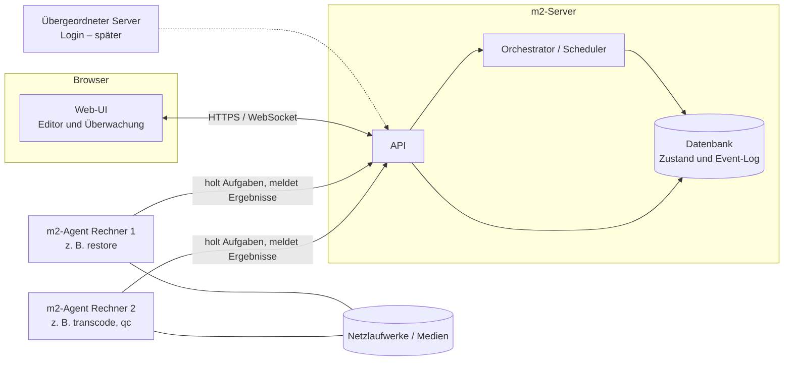

# m2 – Vorüberlegungen zur Architektur

**Protokoll** · 29.10.2026 · Martin, CodeZilla (Beratung)
**Status:** Vorüberlegung. Kein Pflichtenheft, kein Code, noch keine endgültigen Entscheidungen.

---

## 1. Ausgangslage

- **Marathon 1.x** (`PROGRESS-MAM/Marathon`, v1.17/1.18): Python-Konsolenprogramm (Windows) mit fest verdrahteter Abfolge Restore → Transcode → QC für EditShare/Veritone. Den Zustand speichert es in einer einzigen JSON-Datei, die Jobs liegen als Dateien in Ordnern auf dem Netzlaufwerk (`offen/` → `laufend/<worker>/`). Die Worker melden sich über Report- und Heartbeat-Dateien zurück.
- **m2 (Marathon 2.0):** harter Schnitt, neues Repo, es wird nichts übernommen.
- **Ziel:** eine Workflow-Engine nach dem Vorbild von FFAStrans. Sie läuft als Webseite im lokalen Netz und kann optional öffentlich erreichbar sein. Login und Benutzerverwaltung kommen später über einen übergeordneten Server.
- **Module:** restore, transcode, qc, Dateien bewegen, es-searcher und später weitere. Heute geht es nur um das Framework.
- **Beobachtbarkeit auf drei Ebenen:** Clip (jeden Clip nachverfolgen), Modul (was macht es, was hat es gemacht) und Workflow (Gesamtstatus).

## 2. Was wir aus Marathon 1 mitnehmen (Erfahrungen, kein Code)

| Hat sich bewährt → wieder vorsehen | Hat Grenzen gezeigt → in m2 anders lösen |
|---|---|
| Pull-Prinzip: Worker holen sich ihre Arbeit selbst | Zustand in einer JSON-Datei → stattdessen eine Datenbank |
| Heartbeat, Versuchszähler, manuelles Wiederfreigeben (`retry-*`) | Ordner als Warteschlange → Sperren, Atomarität und Parallelität sind schwierig |
| Sammeljobs (Restore je Band) mit Teilberichten während der Laufzeit | Fest verdrahtete Stufen → stattdessen frei kombinierbare Module |
| Versionierte Schnittstellen (`schema_version`) | Konsole als einzige Oberfläche → stattdessen Web-UI mit Live-Status |
| Prioliste | Auswertungen nur als Berichtsdateien → stattdessen Abfragen auf Clip-, Modul- und Workflow-Ebene |

Die Fachbibliotheken (TOOLBOX, ES-Search, ES-Restore/ES-ARK-API, AQC, Transcoder) gehören nicht zum Marathon-Code. Ob sie später in m2-Modulen verwendet werden, ist noch offen (siehe Abschnitt 6).

## 3. Frage 1: Gibt es so ein Framework schon? Lässt sich ein bestehendes umbauen?

**Kurzantwort:** Kein freies Open-Source-Produkt (FOSS) deckt die ganze Kombination ab: visueller Web-Editor, verteilte Worker, Verfolgung einzelner Clips durch einen langlebigen Workflow und Sammeljobs. Es gibt aber gute Bausteine und eine Engine, die als Basis ernsthaft in Frage käme.

### 3.1 Fertige Systeme

| Kandidat | Was passt | Was fehlt / Risiko | Lizenz | Einschätzung |
|---|---|---|---|---|
| **FFAStrans** | Unser Vorbild. Portabel vom SMB-Share, gleichberechtigte Farm-Rechner, Weboberfläche und REST-API | Editor ist eine Windows-Anwendung, nicht in unserem Sinn erweiterbar, kein offener Quellcode | Freeware | Vorbild für die Konzepte |
| **FileFlows** | Funktional am nächsten dran: Web-Flow-Editor, Server mit verteilten Nodes, Verfolgung pro Datei | Proprietär, Lizenzstufen, keine Anbindung an ES/Ark | proprietär | Nur als Vorlage für Bedienung und Oberfläche |
| **Tdarr** | Server mit Nodes, Flows, Bibliotheks-Tracking | Proprietär (EULA verbietet Weitergabe und Reverse Engineering) | proprietär | Nur als Vorlage für Bedienung und Oberfläche |
| **Windmill** | Visueller Flow-Editor, Python-Skripte als Schritte, Worker auch unter Windows ohne Docker, Routing per Tags | Denkt in einzelnen Läufen, nicht in Clips, die durch eine langlebige Pipeline wandern. Sammeljobs sind umständlich, die Oberfläche lässt sich kaum auf Medien zuschneiden. Erweiterte Worker-Gruppen sind kostenpflichtig | gemischt: AGPLv3 / Apache-2.0 / eigene Bedingungen | Einzige ernsthafte Basis-Option. Ein kurzer Test (Spike) ist möglich |
| **Kestra** | Apache-2.0, Windows-Remote-Worker dokumentiert, Topologie-Ansicht | YAML-zentriert, Java, Worker Groups nur in der Enterprise-Version | Apache-2.0 | Eher nicht |
| **n8n** | Bester Canvas-Editor | Keine OSI-Lizenz, Schwerpunkt API-Automatisierung, Worker auf Node.js-Basis | Sustainable Use License | Nein |
| **Prefect / Airflow** | Python, ausgereift | Kein visueller Editor (Workflows werden im Code geschrieben), die UI dient nur der Überwachung | Apache-2.0 | Nein |
| **Apache NiFi** | Herkunftsnachweis (Provenance) pro FlowFile – genau das, was wir pro Clip wollen | Schwergewichtig (Java), ausgelegt auf Datenströme statt auf lange externe Verarbeitung | Apache-2.0 | Vorbild für das Konzept der Clip-Historie |
| **OpenMPF** | Pipelines, Weboberfläche, Skalierung über Nodes | Auf Medienanalyse (Erkennung/Extraktion) ausgerichtet | Apache-2.0 | Nein |

### 3.2 Bausteine für einen eigenen Kern

| Zweck | Empfehlung | Hinweis |
|---|---|---|
| Node-Editor im Browser | **React Flow (xyflow)**, MIT | Aktiv gepflegt, gut anpassbar |
| Alternative Editoren | Rete.js (überwiegend MIT), Drawflow (MIT) | Bei Rete einzelne Plugins unter CC-BY-NC-SA meiden; Drawflow ist klein und wird wenig weiterentwickelt |
| Warteschlange/Ausführung | PostgreSQL als Queue (selbst gebaut) **oder** **Hatchet** (MIT, Python-SDK, eigene UI) | Hatchet bei Bedarf als Ausführungsschicht prüfen |

### 3.3 Empfehlung

**Ein eigener, schlanker Kern aus fertigen Bausteinen statt einer umgebauten Fremd-Engine.**
Der eigentliche Nutzen von m2 liegt im Clip als verfolgbarer Einheit, in Sammeljobs, in medienspezifischen Ansichten und in Workern mit Fähigkeiten wie Bandzugriff, GPU oder Share-Zugriff. Genau das bilden generische Engines nicht ab. Wer eine solche Engine umbaut, arbeitet dauerhaft gegen ihr Datenmodell.
Optional lässt sich das mit einem Windmill-Test von 1–2 Tagen bestätigen oder widerlegen.

## 4. Frage 2: Worker über die Webseite einbinden, ganz ohne Installation?

**Kurzantwort:**
- Rechner über die Webseite **einbinden, verwalten und ihnen Aufgaben zuteilen: Ja.**
- Rechenlast **im Browser-Tab ohne jede Installation** verteilen: technisch nur begrenzt möglich, **für die m2-Module praktisch nein.**

### 4.1 Was der Browser darf

| Ressource | Was der Browser kann | Grenze für m2 |
|---|---|---|
| **CPU** | Web Workers und WebAssembly, mehrere Threads (SharedArrayBuffer nur mit Cross-Origin-Isolation) | Kann keine nativen Programme starten (ffmpeg, Prüftools, Ark-Client). WebAssembly-Fassungen wie ffmpeg.wasm sind deutlich langsamer als nativ |
| **GPU** | WebGPU (aktuelle Versionen von Chrome, Edge, Firefox und Safari) für Berechnungen; WebCodecs für hardwarebeschleunigtes De-/Encoding | Nur Codecs, die Browser und Betriebssystem anbieten (typisch H.264/HEVC/VP9/AV1, je nach Gerät unterschiedlich). Archiv- und Mezzanine-Formate wie ProRes, DNxHD, JPEG 2000 oder DPX gehören nicht dazu. Keine direkte Steuerung von NVENC & Co. |
| **Arbeitsspeicher** | Pro Tab begrenzt; WebAssembly üblicherweise bis 4 GB, mit Memory64 mehr (Chrome/Firefox, nicht Safari) | Große Mediendateien lassen sich nur gestückelt verarbeiten |
| **Lokaler Speicher** | Origin Private File System: ein abgeschotteter Speicher mit Kontingent | Kein Zugriff auf normale Ordner, die Daten liegen nur browserintern |
| **Ordner / Netzlaufwerke** | File System Access (`showDirectoryPicker`) – nur Chromium, nur nach Klick und Freigabe durch den Nutzer | Kein SMB, keine UNC-Pfade, keine Pfadvorgabe durch den Server. Ob Netzlaufwerke zuverlässig funktionieren, ist nicht garantiert. Firefox und Safari bieten die Funktion nicht |
| **Netzwerk** | HTTP(S), WebSocket, WebRTC, nur mit CORS-Freigabe der Gegenseite | Keine freien Netzwerkverbindungen; Direct Sockets ist nur für installierte, isolierte Web-Apps vorgesehen, also wieder eine Installation |
| **Dauerbetrieb** | Läuft, solange der Tab offen ist | Drosselung im Hintergrund, Energiesparmodus, Browser-Updates, versehentlich geschlossene Tabs |
| **Voraussetzung** | WebGPU, File System Access und Ähnliches brauchen HTTPS | Auch im LAN ist ein Zertifikat nötig |

**Fazit:** Browser-Worker eignen sich höchstens für leichte, abgeschlossene Aufgaben auf hochgeladenen Daten, etwa Prüfsummen, Vorschaubilder oder einfache Analysen von Proxys. Restore (Band/Ark), Transcode von Archivformaten, QC mit Prüftools und das Verschieben von Dateien auf Shares brauchen einen nativen Prozess auf dem Rechner.

### 4.2 „Fast ohne Installation“ – realistische Wege

| Weg | Beschreibung | Aufwand am Rechner |
|---|---|---|
| **A: Portabler Agent vom Share** (FFAStrans-Prinzip) | Der Agent liegt einmal auf dem Netzlaufwerk und wird von jedem Rechner von dort gestartet (Autostart oder Dienst) | Kein Installer, nur einmal den Start einrichten |
| **B: Agent einmal installieren, danach alles über die Webseite** | Kopplung per Code/Token. Freigeben, Sperren, Fähigkeiten, Gruppen und Parallelität stellt man in der Web-UI ein. Module und Updates verteilt der Server | Einmalig |
| **C: Container** | Gleicher Agent als Docker-Image für Linux-Rechner | Einmalig, wenn Docker vorhanden ist |

**Empfehlung:** B als Grundmodell, mit A als Verteilweg für Windows. Browser-Worker höchstens später als Nische.

### 4.3 So sähe die Einbindung über die Webseite aus

1. Der Agent startet und meldet sich beim Server. In der Web-UI erscheint er als „neu“.
2. In der Web-UI: freigeben, benennen, Gruppen/Tags vergeben, maximale Zahl paralleler Aufgaben und Pfad-Zuordnungen festlegen.
3. Der Server teilt Aufgaben passend zu den Fähigkeiten zu, der Agent holt sie ab.
4. Der Agent baut nur **ausgehende** Verbindungen auf. Das ist wichtig für Firewalls und den späteren öffentlichen Zugang.

## 5. Architektur-Skizze (Vorschlag)

**Komponenten**

- **m2-Server:** Web-UI, API, Orchestrator/Scheduler, Datenbank mit Event-Log. Eine zentrale Instanz.
- **m2-Agent:** läuft auf jedem Worker-Rechner und führt die Module aus.
- **Module:** Plugins mit Manifest. Der Server kennt nur das Manifest, ausgeführt wird im Agent.
- **Medien:** bleiben auf den Shares. m2 verwaltet nur Referenzen (Speicherort und relativer Pfad), die Pfad-Zuordnung erfolgt je Worker.
- **Später:** übergeordneter Server für Login vor m2 (Reverse Proxy oder Token). Eine Andockstelle ist vorgesehen, gebaut wird sie noch nicht.

### 5.1 Kernbegriffe

| Begriff | Bedeutung |
|---|---|
| **Workflow** | Versionierte Definition: ein Graph aus Knoten und Verbindungen |
| **Knoten** | Eine Modul-Instanz mit Parametern im Workflow |
| **Clip** | Die Einheit, die durch den Workflow wandert, mit Metadaten und Dateireferenzen |
| **Task** | Die Ausführung eines Knotens für einen oder mehrere Clips (Batch) auf einem Worker, inklusive Versuchen |
| **Event** | Jede Zustandsänderung; Events werden nur angehängt, nie verändert |
| **Worker** | Ein Agent mit Fähigkeiten, Status und Heartbeat |

### 5.2 Drei Sichten aus einem Datenbestand

| Sicht | Beantwortet | Grundlage |
|---|---|---|
| **Workflow** | Wie viele Clips sind in welchem Knoten und Zustand? Wie hoch sind Durchsatz, Fehlerquote und Auslastung der Worker? | Zusammenfassung des aktuellen Zustands |
| **Modul / Knoten** | Was wartet, läuft, ist fertig oder fehlgeschlagen? Was steht in den Logs, welche Worker arbeiten daran? | Tasks des Knotens |
| **Clip** | Wie verlief der Weg durch alle Knoten (Zeitstrahl)? Welche Versuche, Worker, Dateien und Logs gab es? | Events des Clips |

Grundprinzip: Das **Event-Log ist die Quelle der Wahrheit**, der aktuelle Zustand wird daraus abgeleitet (vergleichbar mit der Provenance in NiFi). Damit entsteht die Clip-Historie automatisch, ohne Zusatzaufwand.

### 5.3 Ausführung

- **Pull mit Lease:** Der Agent fragt nach Arbeit, die zu seinen Fähigkeiten passt. Der Server vergibt einen Task mit Ablaufzeit, der Heartbeat verlängert sie. Fällt der Agent aus, kommt der Task zurück in die Warteschlange.
- **Routing** über Fähigkeiten und Tags (z. B. `tape`, `gpu`, `share:defa`).
- **Fehlerpfade:** Jeder Knoten hat mehrere Ausgänge (Erfolg, Fehler, ggf. weitere). Dazu kommen Retry-Regeln je Knoten und eine manuelle Wiederfreigabe in der UI.
- **Sammeln/Verteilen** als eingebaute Steuerelemente, z. B. Clips nach Band sammeln, Restore als Batch, danach wieder einzeln weiter.
- **Prioritäten und Kontingente** je Workflow und Knoten.
- **Workflow-Versionen:** Laufende Clips bleiben auf der Version, mit der sie gestartet sind.
- **Live-Status** in der UI über WebSocket oder Server-Sent Events.

### 5.4 Modul-Vertrag (Grundidee)

- **Manifest:** Name, Version, Ein- und Ausgänge, Parameter-Schema (daraus erzeugt die UI das Formular), benötigte Fähigkeiten, Batch ja/nein, Parallelität.
- **Laufzeit:** Eingabe sind Clip(s) und Parameter. Das Modul liefert Fortschritt, Logs und ein Ergebnis je Clip (bei Batch auch Teilergebnisse während der Laufzeit).
- **Modularten:**
  - Quelle/Auslöser: es-searcher, Watchfolder, manuell
  - Verarbeitung: restore, transcode, qc
  - Aktion: Dateien bewegen, Metadaten setzen
  - Steuerung: Bedingung, Sammeln, Verteilen, Warten/Freigabe

### 5.5 Technische Richtung (vorläufig)

| Bereich | Tendenz | Grund |
|---|---|---|
| Backend | Python (z. B. FastAPI) | Vorhandenes Python-Know-how, Fachbibliotheken sind in Python |
| Datenbank | PostgreSQL (SQLite nur für einen Prototyp) | Robuste Warteschlange (`SKIP LOCKED`), JSON-Felder, Benachrichtigungen |
| Frontend | Web-App mit React Flow als Editor | Siehe 3.2 |
| Agent | Python, als portables Paket | Module in Python, Verteilweg A/B |
| Transport | HTTPS von Anfang an | Browserfunktionen, späterer öffentlicher Zugang |
| Login | Nur eine Andockstelle vorsehen | Kommt später vom übergeordneten Server |

### 5.6 Dateiablage im Dateisystem (Marschrichtung)

- **Ein Ordner je Job:** Alle Mediendateien eines Jobs liegen gemeinsam in einem Ordner (z. B. benannt nach dem Jobnamen), nicht verteilt auf Stufenordner.
- **Möglichst flach:** Am besten alles in einer Ebene, ohne Unterordner. Welche Datei zu welchem Clip und zu welcher Stufe gehört, steht in der Datenbank, nicht in der Ordnerstruktur.
- **Beispiel Restore → Transcode → Delivery → Cleanup:** Restored File und Transcoded File liegen im selben Jobordner. Jobdateien (falls vorhanden) liegen ebenfalls dort.
- **Cleanup:** Nach erfolgreicher Delivery löscht das Cleanup-Modul den ganzen Jobordner samt Inhalt. Es braucht keine Einzeldatei-Logik.
- **Offen für die Detailplanung:** Namensschema der Dateien (Kollisionen in einer Ebene vermeiden), Ablageort des Jobordners je Share, Verhalten bei fehlgeschlagener Delivery.

## 6. Offene Architekturfragen (nächste Sitzung)

1. **Workflow-Modell:** langlebige Pipeline, in die laufend Clips einlaufen (Marathon-Stil), oder ein Job je Datei (FFAStrans-Stil)? Oder beides?
2. **Worker-Betriebssysteme:** nur Windows oder auch Linux/Container?
3. **Wo laufen Quell-Module** wie der es-searcher: auf dem Server oder in einem Agent?
4. **Speicher:** ein Share oder mehrere Standorte? Wie werden Pfade zwischen Windows und Linux zugeordnet?
5. **Größenordnung:** Clips je Workflow, Anzahl der Worker, Aufbewahrungsdauer der Historie.
6. **Verteilung des Agents:** portabel vom Share oder Installation als Dienst? Gibt es IT-Vorgaben?
7. **Rolle des übergeordneten Servers:** nur Login oder auch mehrere m2-Instanzen bzw. Mandanten?
8. **Windmill-Test** durchführen: ja oder nein?
9. **Fachbibliotheken** (TOOLBOX, ES-Search, ES-Restore, AQC, Transcoder) in Modulen weiterverwenden?

## 7. Stand heute

- **Festgelegt:** Name m2, neues Repo, harter Schnitt. Benutzerverwaltung und Login vorerst nicht.
- **Tendenz (noch nicht entschieden):** eigener Kern aus fertigen Bausteinen; Agent statt Browser-Worker; ereignisbasierte Clip-Verfolgung.

## Quellen

- FFAStrans Architektur: https://www.ffastrans.com/wiki/doku.php?id=gui%3Aarchitecture
- FFAStrans Weboberfläche: https://www.ffastrans.com/wiki/doku.php?id=webinterface%3Awebinterface
- FileFlows Preise/Lizenz: https://fileflows.com/pricing
- Tdarr (EULA): https://github.com/HaveAGitGat/Tdarr
- Windmill Lizenz: https://github.com/windmill-labs/windmill/blob/main/LICENSE
- Windmill Worker-Gruppen: https://www.windmill.dev/docs/core_concepts/worker_groups
- Kestra Worker Groups: https://kestra.io/docs/enterprise/scalability/worker-group
- n8n Lizenz-FAQ: https://docs.n8n.io/n8n-community-license/community-license/license-faq
- Prefect Workers: https://docs.prefect.io/v3/concepts/workers
- Apache NiFi in Depth (Provenance): https://nifi.apache.org/docs/nifi-docs/html/nifi-in-depth.html
- OpenMPF: https://github.com/openmpf/openmpf
- React Flow (xyflow): https://github.com/xyflow/xyflow
- Rete.js Lizenzen: https://retejs.org/docs/licensing/
- Hatchet: https://docs.hatchet.run/v1
- MDN WebGPU: https://developer.mozilla.org/en-US/docs/Web/API/WebGPU_API
- MDN WebCodecs: https://developer.mozilla.org/en-US/docs/Web/API/WebCodecs_API
- MDN showDirectoryPicker: https://developer.mozilla.org/en-US/docs/Web/API/Window/showDirectoryPicker
- Cross-Origin-Isolation: https://web.dev/articles/cross-origin-isolation-guide
- Wasm Memory64: https://caniuse.com/wf-wasm-memory64
